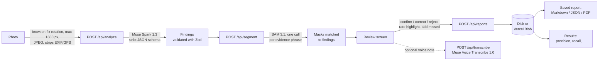

# Architecture

PathAble AI is a single Next.js 15 app (App Router, TypeScript, React 19). The browser prepares the photo and drives the pipeline; server route handlers hold the Meta API key and call the Meta Model API; a person reviews every finding before anything is saved.

## Data flow

## Components

| Layer | Files | Responsibility |
| --- | --- | --- |
| Photo preparation | `lib/prepare-image.ts` | Decodes with EXIF orientation applied, scales to at most 1600 px, re-encodes as JPEG (which drops GPS and other metadata). |
| Pipeline (browser) | `lib/pipeline.ts` | Calls analyze, then segment; shows findings as soon as analysis returns; marks evidence unavailable if segmentation fails. Shared by single uploads and batch analysis. |
| Analysis | `lib/analyze.ts`, `app/api/analyze` | Muse Spark 1.3 via the OpenAI-compatible Chat Completions API with a strict `json_schema`. The reply is parsed with Zod: bad values fall back to safe defaults, at most 10 findings are kept, and a finding with no usable location is kept but marked *unlocated*. |
| Evidence | `lib/segment.ts`, `lib/geometry.ts`, `app/api/segment` | SAM 3.1 via the streaming Responses API, decoded with `@meta-sam/parser`. A mask counts as evidence when at least 40% of it lies inside the finding's box (padded by 15%); otherwise the best mask with IoU of at least 0.1 is used; otherwise the finding falls back to an *approximate* box. Shared phrases are segmented once; overlapping findings never claim the same object twice, except when both describe one single object. |
| Voice notes | `lib/record-voice.ts`, `lib/wav.ts`, `lib/transcribe.ts`, `app/api/transcribe` | The browser records up to 60 s and converts it to 16 kHz mono WAV; the server checks the WAV header and sends it to Muse Voice Transcribe 1.0 with accessibility keywords. The transcript is added to the field for the reviewer to edit. |
| Review | `components/ReviewSession.tsx`, `FindingCard.tsx`, `FindingReviewControls.tsx`, `MissedIssuesEditor.tsx` | Each card separates the **AI interpretation** from the **visible evidence**, and shows whether the finding is still unverified. A report can be saved only when every finding is reviewed and the sharing statement is confirmed; the server rejects a report without it and records when it was given. |
| Validation | `lib/report-validate.ts`, `lib/image-input.ts`, `lib/http.ts` | Everything the browser sends is re-validated on the server: image type and size, body size (checked while streaming, so a missing Content-Length cannot bypass it), every field's type and range, SVG outline paths restricted to `M L Z`, digits and spaces, and complete reviews. |
| Storage | `lib/store.ts` | One JSON file and one JPEG per item. Local disk by default; a private Vercel Blob store when `BLOB_READ_WRITE_TOKEN` is set. IDs are UUIDs checked by pattern, so paths cannot escape the data folder. |
| Measurement | `lib/metrics.ts`, `app/results` | Precision, recall, category accuracy, highlight quality, false-alarm rate and review time, from human verdicts, with 95% Wilson intervals. |
| Public-deployment protections | `lib/owner.ts`, `lib/rate-limit.ts` | Owner key for the evaluation tools and for deleting saved reports (fails closed on Vercel), per-visitor hourly limits, a daily cap on all AI calls, and a pause switch. |

## Trust boundaries

- **The API key never reaches the browser.** It is read only in server modules marked `server-only`; responses and error messages never include it (covered by tests).
- **Model output is untrusted.** It is schema-constrained at the API, then validated with Zod before use. SVG outlines are generated by the app from mask data, and saved outlines are re-validated against a strict path pattern before storage.
- **The browser is untrusted.** Reports are rebuilt from validated fields on the server; the server never trusts the client's claim that a review is complete.
- **Findings are never conclusions.** The prompt forbids compliance claims; the UI labels every finding as AI interpretation until a person confirms it; saved reports state what the reviewer verified.

## Failure handling

| Failure | Behaviour |
| --- | --- |
| Muse Spark times out (45 s) or is rate-limited | 504 / 503 with a plain message; the user can retry. No automatic retries, so calls stay inside the 60 s route limit. |
| Malformed model reply | 502 "did not match the expected structure"; individual bad fields fall back to safe defaults instead. |
| SAM call fails, times out (40 s) or returns truncated output | Only that finding shows "Segmentation was unavailable" and its approximate box; other findings are unaffected. |
| SAM finds nothing in the area | Dashed *approximate* box and a prompt to check carefully. |
| Oversized or invalid upload | 400 / 413 before any model call. |
| Storage write fails | 500 with a retry message; the review stays on screen. |

## Testing

`npm test` runs 42 tests with Node's built-in test runner. The Meta API is replaced by a local mock server (`tests/mock-meta.ts`) that speaks the same Chat Completions, SAM streaming and transcription formats, so the tests exercise the real client code without network calls or cost. `npm run lint` (ESLint with Next.js rules), `npm run typecheck` and `npm run build` complete the checks.
